# Map report

Generated by `build/quark_tests mapreport` from the map files, the bot nav graph and line-of-sight rays. Metric definitions and score formulas: [MAP_METRICS.md](MAP_METRICS.md). Scores are 0-10; a dash means not applicable.

## Movement envelope

Measured with the game's movement code: the speed a good player builds with auto-bhop, strafing and dashes (after so many metres of moving from a standstill), and what a jump plus an upward dash reaches from that speed. The tech checks below use these.

| speed | run-up | rise | across, level | across, 3.5 m up | across, 8 m up | after a 20 m grapple pull |
|---|---|---|---|---|---|---|
| 9.5 m/s | 0 m | 8.9 m | 42.0 m | 38.0 m | 30.0 m | 24 m/s |
| 12 m/s | 0 m | 8.9 m | 42.0 m | 38.0 m | 30.0 m | 24 m/s |
| 16 m/s | 0 m | 8.9 m | 42.5 m | 38.5 m | 30.5 m | 24 m/s |
| 20 m/s | 0 m | 9.7 m | 42.5 m | 38.5 m | 30.5 m | 24 m/s |
| 24 m/s | 0 m | 11.3 m | 46.5 m | 42.5 m | 36.0 m | 24 m/s |
| 28 m/s | 0 m | 13.3 m | 58.0 m | 54.0 m | 47.5 m | 28 m/s |
| 32 m/s | 10 m | 15.0 m | 66.5 m | 62.5 m | 55.5 m | 32 m/s |
| 36 m/s | 10 m | 15.0 m | 68.5 m | 64.0 m | 57.5 m | 36 m/s |

## Scores

| map | for | setting | decor | layout | movement | creativity | mode fit | balance | originality |
|---|---|---|---|---|---|---|---|---|---|
| anvil | 1v1 | smithy | 8.0 | 7.2 | 8.7 | 7.5 | 8.5 | 10.0 | 2.7 |
| bastion | vs | castle | 7.2 | 7.7 | 8.9 | 8.2 | 7.5 | 10.0 | 3.2 |
| canal | npayload | canal town | 7.4 | 7.1 | 8.6 | 7.5 | 9.0 | 10.0 | 2.2 |
| clockwork | duel | inside a giant clock | 8.5 | 8.5 | 8.0 | 7.2 | 10.0 | 10.0 | 2.8 |
| colosseum | tourney | roman arena | 7.1 | 7.1 | 7.9 | 7.5 | 7.4 | 10.0 | 2.8 |
| depot | bomb | freight depot | 8.8 | 7.1 | 8.8 | 7.5 | 9.1 | 10.0 | 2.8 |
| dojo | 1v1 | dojo | 8.4 | 1.7 | 5.4 | 4.5 | 7.5 | 10.0 | 10.0 |
| downtown | koth | city block | 9.5 | 9.1 | 8.3 | 7.5 | 7.6 | 10.0 | 3.1 |
| foundry | tag | factory floor | 7.7 | 7.3 | 8.0 | 8.2 | 7.1 | - | 2.2 |
| furnace | 1v1 | blast furnace | 8.2 | 7.5 | 9.0 | 7.5 | 9.0 | 10.0 | 2.7 |
| gantry | ffa | crane hall | 8.6 | 7.6 | 9.1 | 7.5 | 7.6 | - | 3.8 |
| hamlet | hide | valley village | 7.2 | 7.3 | 8.3 | 8.0 | 8.6 | - | 2.5 |
| harbor | ffa | harbour | 7.5 | 7.5 | 8.3 | 7.5 | 7.4 | - | 2.6 |
| hightown | hide | skyscraper over a city | 8.1 | 7.5 | 8.5 | 8.0 | 8.8 | - | 7.7 |
| lodestone | points | mine | 7.4 | 7.6 | 9.4 | 8.0 | 8.6 | 8.7 | 1.5 |
| midtown | points | city centre | 7.4 | 7.5 | 8.1 | 8.0 | 8.7 | 10.0 | 1.5 |
| orbital | vs | space station | 8.9 | 8.4 | 8.2 | 7.2 | 9.8 | 10.0 | 3.1 |
| railyard | payload | rail yard | 8.0 | 7.3 | 8.3 | 7.5 | 9.6 | - | 2.7 |
| summit | koth | mountain peak | 7.3 | 7.9 | 9.3 | 7.5 | 10.0 | 10.0 | 2.7 |
| temple | 1v1 | pagoda temple on a mountain top | 7.2 | 7.2 | 8.6 | 7.5 | 7.5 | 10.0 | 4.0 |
| viaduct | race | mountain gorge | 9.3 | 7.1 | 8.7 | 8.8 | 7.9 | - | 10.0 |

## Decor / detail

| map | brushes | detail | per 100 m² | bare walls | materials | glow | metal | lights | skyline |
|---|---|---|---|---|---|---|---|---|---|
| anvil | 550 | 351 | 12.1 | 19% | 8 | 105 | 38 | 34 | 30 |
| bastion | 1181 | 854 | 11.0 | 38% | 8 | 38 | 61 | 38 | 68 |
| canal | 753 | 476 | 11.6 | 20% | 8 | 114 | 56 | 26 | 60 |
| clockwork | 444 | 325 | 17.9 | 33% | 6 | 50 | 33 | 36 | 0 |
| colosseum | 733 | 461 | 8.8 | 27% | 7 | 109 | 43 | 43 | 62 |
| depot | 893 | 677 | 14.8 | 2% | 8 | 149 | 59 | 25 | 52 |
| dojo | 366 | 225 | 42.4 | 11% | 7 | 47 | 10 | 17 | 64 |
| downtown | 833 | 653 | 16.9 | 3% | 8 | 250 | 49 | 33 | 52 |
| foundry | 753 | 603 | 11.1 | 20% | 8 | 64 | 252 | 35 | 8 |
| furnace | 514 | 335 | 13.0 | 13% | 8 | 112 | 32 | 30 | 26 |
| gantry | 1034 | 773 | 11.2 | 4% | 8 | 153 | 129 | 52 | 60 |
| hamlet | 1787 | 1432 | 8.4 | 22% | 8 | 219 | 150 | 44 | 80 |
| harbor | 664 | 451 | 9.8 | 23% | 8 | 158 | 79 | 41 | 54 |
| hightown | 1185 | 980 | 10.3 | 11% | 7 | 85 | 84 | 56 | 89 |
| lodestone | 10447 | 6837 | 8.2 | 17% | 7 | 1440 | 516 | 99 | 144 |
| midtown | 11677 | 8943 | 9.1 | 22% | 8 | 1230 | 1501 | 200 | 122 |
| orbital | 741 | 503 | 15.8 | 9% | 7 | 127 | 80 | 26 | 110 |
| railyard | 926 | 659 | 12.0 | 16% | 7 | 151 | 104 | 32 | 60 |
| summit | 663 | 454 | 9.2 | 23% | 8 | 141 | 45 | 37 | 64 |
| temple | 860 | 522 | 7.4 | 16% | 8 | 116 | 29 | 42 | 101 |
| viaduct | 2067 | 1639 | 55.8 | 17% | 8 | 413 | 271 | 40 | 85 |

## Layout and sightlines

Range bands follow the weapon table: long is out to the laser's reach (24 m).

| map | floor m² | levels | height range | loops | dead ends | visible pairs | <6 m | 6-20 m | 20-24 m | >24 m | cover |
|---|---|---|---|---|---|---|---|---|---|---|---|
| anvil | 2898 | 5 | 8.5 m | 10.0 | 2 | 45% | 7% | 45% | 14% | 35% | 42% |
| bastion | 7735 | 7 | 12.9 m | 29.8 | 0 | 35% | 4% | 21% | 6% | 69% | 40% |
| canal | 4087 | 5 | 7.2 m | 15.0 | 0 | 46% | 4% | 27% | 10% | 59% | 35% |
| clockwork | 1812 | 5 | 7.3 m | 7.0 | 0 | 50% | 9% | 50% | 13% | 28% | 56% |
| colosseum | 5256 | 5 | 6.5 m | 15.0 | 0 | 38% | 6% | 38% | 13% | 43% | 32% |
| depot | 4584 | 5 | 11.5 m | 9.5 | 0 | 33% | 7% | 37% | 10% | 46% | 42% |
| dojo | 530 | 1 | 0.0 m | 0.0 | 1 | 100% | 16% | 77% | 6% | 1% | 0% |
| downtown | 3863 | 8 | 12.0 m | 12.0 | 0 | 33% | 8% | 45% | 13% | 34% | 52% |
| foundry | 5444 | 5 | 6.4 m | 17.5 | 0 | 53% | 3% | 25% | 9% | 63% | 40% |
| furnace | 2583 | 5 | 10.0 m | 8.0 | 0 | 38% | 8% | 56% | 13% | 23% | 38% |
| gantry | 6902 | 9 | 22.0 m | 20.0 | 2 | 31% | 4% | 23% | 8% | 66% | 45% |
| hamlet | 17007 | 9 | 13.3 m | 33.0 | 1 | 12% | 5% | 27% | 8% | 60% | 44% |
| harbor | 4606 | 5 | 8.4 m | 15.0 | 0 | 31% | 7% | 39% | 10% | 44% | 39% |
| hightown | 9549 | 16 | 23.9 m | 20.0 | 0 | 12% | 7% | 44% | 14% | 34% | 34% |
| lodestone | 82994 | 12 | 17.2 m | 206.0 | 0 | 6% | 2% | 14% | 5% | 79% | 47% |
| midtown | 98056 | 10 | 14.6 m | 259.8 | 0 | 5% | 2% | 14% | 4% | 80% | 45% |
| orbital | 3187 | 6 | 10.4 m | 12.0 | 0 | 26% | 12% | 54% | 11% | 23% | 48% |
| railyard | 5500 | 5 | 12.2 m | 12.0 | 0 | 28% | 7% | 40% | 11% | 42% | 44% |
| summit | 4926 | 5 | 7.5 m | 16.0 | 0 | 45% | 5% | 36% | 12% | 47% | 47% |
| temple | 7043 | 8 | 12.2 m | 22.5 | 0 | 23% | 6% | 36% | 9% | 49% | 21% |
| viaduct | 2938 | 18 | 31.5 m | 0.0 | 1 | 9% | 18% | 46% | 9% | 26% | 55% |

### Layout points

| map | levels (/2) | loops (/2) | cover (/3) | range mix (/3) | dead ends (-) |
|---|---|---|---|---|---|
| anvil | 1.2 | 2.0 | 2.3 | 2.2 | -0.6 |
| bastion | 1.8 | 2.0 | 2.2 | 1.7 | -0.0 |
| canal | 1.2 | 2.0 | 1.9 | 2.0 | -0.0 |
| clockwork | 1.2 | 2.0 | 3.0 | 2.3 | -0.0 |
| colosseum | 1.2 | 1.9 | 1.8 | 2.2 | -0.0 |
| depot | 1.2 | 1.4 | 2.3 | 2.1 | -0.0 |
| dojo | 0.2 | 0.0 | 0.0 | 1.8 | -0.3 |
| downtown | 2.0 | 2.0 | 2.8 | 2.2 | -0.0 |
| foundry | 1.2 | 2.0 | 2.2 | 1.8 | -0.0 |
| furnace | 1.2 | 2.0 | 2.1 | 2.1 | -0.0 |
| gantry | 2.0 | 1.9 | 2.4 | 1.8 | -0.6 |
| hamlet | 2.0 | 1.3 | 2.4 | 1.9 | -0.3 |
| harbor | 1.2 | 2.0 | 2.1 | 2.1 | -0.0 |
| hightown | 2.0 | 1.4 | 1.9 | 2.2 | -0.0 |
| lodestone | 2.0 | 1.7 | 2.6 | 1.4 | -0.0 |
| midtown | 2.0 | 1.8 | 2.5 | 1.3 | -0.0 |
| orbital | 1.5 | 2.0 | 2.6 | 2.3 | -0.0 |
| railyard | 1.2 | 1.5 | 2.4 | 2.2 | -0.0 |
| summit | 1.2 | 2.0 | 2.5 | 2.1 | -0.0 |
| temple | 2.0 | 2.0 | 1.1 | 2.0 | -0.0 |
| viaduct | 2.0 | 0.0 | 3.0 | 2.4 | -0.3 |

## Movement

Sub-scores 0-10 (the movement score is their mean); the measurement behind each in brackets.

| map | grapple (anchors) | speed lanes (p90) | vertical (jump links, levels) | headroom (>6 m) | risk (near a lethal drop) | tech payoff |
|---|---|---|---|---|---|---|
| anvil | 10.0 (98%) | 8.8 (35 m) | 8.0 (55%, 5) | 9.1 (82%) | 8.9 (6%) | 7.4 |
| bastion | 9.1 (72%) | 10.0 (49 m) | 10.0 (65%, 7) | 9.2 (83%) | 10.0 (22%) | 4.8 |
| canal | 10.0 (86%) | 10.0 (52 m) | 7.5 (66%, 5) | 9.7 (87%) | 10.0 (25%) | 4.2 |
| clockwork | 10.0 (99%) | 7.2 (29 m) | 7.6 (63%, 5) | 8.4 (75%) | 10.0 (21%) | 4.9 |
| colosseum | 10.0 (99%) | 10.0 (41 m) | 7.2 (57%, 5) | 8.7 (78%) | 6.9 (2%) | 4.4 |
| depot | 10.0 (86%) | 10.0 (44 m) | 9.3 (72%, 5) | 8.8 (79%) | 7.8 (4%) | 6.8 |
| dojo | 0.0 (0%) | 6.8 (27 m) | 1.5 (71%, 1) | 10.0 (100%) | 10.0 (17%) | 4.2 |
| downtown | 10.0 (94%) | 9.5 (38 m) | 10.0 (63%, 8) | 9.2 (82%) | 7.0 (2%) | 4.4 |
| foundry | 10.0 (100%) | 10.0 (56 m) | 7.2 (66%, 5) | 9.1 (82%) | 7.4 (3%) | 4.3 |
| furnace | 10.0 (91%) | 8.2 (33 m) | 8.7 (55%, 5) | 7.6 (69%) | 9.2 (6%) | 10.0 |
| gantry | 10.0 (100%) | 10.0 (59 m) | 10.0 (61%, 9) | 9.8 (88%) | 8.1 (4%) | 6.9 |
| hamlet | 10.0 (93%) | 10.0 (60 m) | 10.0 (67%, 9) | 9.3 (83%) | 6.3 (1%) | 4.6 |
| harbor | 10.0 (94%) | 10.0 (51 m) | 8.0 (70%, 5) | 8.6 (78%) | 8.8 (6%) | 4.7 |
| hightown | 10.0 (83%) | 9.8 (39 m) | 9.0 (62%, 16) | 2.1 (19%) | 10.0 (18%) | 10.0 |
| lodestone | 10.0 (97%) | 10.0 (60 m) | 10.0 (42%, 12) | 10.0 (98%) | 6.2 (0%) | 10.0 |
| midtown | 10.0 (94%) | 10.0 (60 m) | 10.0 (55%, 10) | 8.1 (73%) | 6.0 (0%) | 4.4 |
| orbital | 10.0 (99%) | 8.2 (33 m) | 9.3 (62%, 6) | 7.6 (69%) | 10.0 (14%) | 4.2 |
| railyard | 10.0 (89%) | 10.0 (59 m) | 9.5 (69%, 5) | 10.0 (92%) | 6.0 (0%) | 4.2 |
| summit | 10.0 (84%) | 10.0 (42 m) | 7.6 (62%, 5) | 8.9 (80%) | 9.4 (7%) | 10.0 |
| temple | 9.7 (77%) | 10.0 (48 m) | 10.0 (69%, 8) | 7.8 (70%) | 9.5 (7%) | 4.6 |
| viaduct | 10.0 (100%) | 5.2 (21 m) | 10.0 (33%, 18) | 8.8 (80%) | 10.0 (70%) | 7.9 |

Tech payoff:

- **anvil**: movement tech shortens main trips by 1.09x on average (10 for 1.15-1.8x: it pays off without trivialising the map); with every move a good player also reaches 424 m2 the run doesn't (roofs, wall tops), 0 m2 of it outside the playable footprint; 6946 of 107997 leaps need a run-up
- **bastion**: movement tech shortens main trips by 1.02x on average (10 for 1.15-1.8x: it pays off without trivialising the map); with every move a good player also reaches 452 m2 the run doesn't (roofs, wall tops), 0 m2 of it outside the playable footprint; 68845 of 398894 leaps need a run-up
- **canal**: movement tech shortens main trips by 1.01x on average (10 for 1.15-1.8x: it pays off without trivialising the map); with every move a good player also reaches 228 m2 the run doesn't (roofs, wall tops), 0 m2 of it outside the playable footprint; 14116 of 175717 leaps need a run-up
- **clockwork**: movement tech shortens main trips by 1.02x on average (10 for 1.15-1.8x: it pays off without trivialising the map); with every move a good player also reaches 280 m2 the run doesn't (roofs, wall tops), 0 m2 of it outside the playable footprint; 696 of 115986 leaps need a run-up
- **colosseum**: movement tech shortens main trips by 1.01x on average (10 for 1.15-1.8x: it pays off without trivialising the map); with every move a good player also reaches 652 m2 the run doesn't (roofs, wall tops), 0 m2 of it outside the playable footprint; 22155 of 262941 leaps need a run-up
- **depot**: movement tech shortens main trips by 1.07x on average (10 for 1.15-1.8x: it pays off without trivialising the map); with every move a good player also reaches 1064 m2 the run doesn't (roofs, wall tops), 0 m2 of it outside the playable footprint; 19614 of 255359 leaps need a run-up
- **dojo**: movement tech shortens main trips by 1.01x on average (10 for 1.15-1.8x: it pays off without trivialising the map); with every move a good player also reaches 0 m2 the run doesn't (roofs, wall tops), 0 m2 of it outside the playable footprint; 29 of 22165 leaps need a run-up
- **downtown**: movement tech shortens main trips by 1.01x on average (10 for 1.15-1.8x: it pays off without trivialising the map); with every move a good player also reaches 108 m2 the run doesn't (roofs, wall tops), 0 m2 of it outside the playable footprint; 3838 of 128347 leaps need a run-up
- **foundry**: movement tech shortens main trips by 1.01x on average (10 for 1.15-1.8x: it pays off without trivialising the map); with every move a good player also reaches 776 m2 the run doesn't (roofs, wall tops), 0 m2 of it outside the playable footprint; 54156 of 608892 leaps need a run-up
- **furnace**: movement tech shortens main trips by 1.26x on average (10 for 1.15-1.8x: it pays off without trivialising the map); with every move a good player also reaches 208 m2 the run doesn't (roofs, wall tops), 0 m2 of it outside the playable footprint; 1704 of 85443 leaps need a run-up
- **gantry**: movement tech shortens main trips by 1.07x on average (10 for 1.15-1.8x: it pays off without trivialising the map); with every move a good player also reaches 2072 m2 the run doesn't (roofs, wall tops), 0 m2 of it outside the playable footprint; 80149 of 519119 leaps need a run-up
- **hamlet**: movement tech shortens main trips by 1.01x on average (10 for 1.15-1.8x: it pays off without trivialising the map); with every move a good player also reaches 1416 m2 the run doesn't (roofs, wall tops), 0 m2 of it outside the playable footprint; 65628 of 258201 leaps need a run-up
- **harbor**: movement tech shortens main trips by 1.02x on average (10 for 1.15-1.8x: it pays off without trivialising the map); with every move a good player also reaches 892 m2 the run doesn't (roofs, wall tops), 0 m2 of it outside the playable footprint; 17386 of 242731 leaps need a run-up
- **hightown**: movement tech shortens main trips by 1.21x on average (10 for 1.15-1.8x: it pays off without trivialising the map); with every move a good player also reaches 256 m2 the run doesn't (roofs, wall tops), 0 m2 of it outside the playable footprint; 1773 of 347143 leaps need a run-up
- **lodestone**: race: shortcut 10.0 (worst leg 2 at 1.23x; 10 at <= 1.25x, 0 at >= 2.5x), challenge 3.8 on the tech path (3.6 jumps per 100 m, 0% narrow, 0% grappled) - legs: 1: 37 m run / 34 m with tech (1.08x), 2 jumps, 0 m narrow, 0 m grappled; 2: 53 m run / 43 m with tech (1.23x), 2 jumps, 0 m narrow, 0 m grappled; 3: 59 m run / 54 m with tech (1.10x), 3 jumps, 0 m narrow, 0 m grappled; 4: 81 m run / 80 m with tech (1.01x), 1 jumps, 0 m narrow, 0 m grappled; 5: 76 m run / 75 m with tech (1.01x), 3 jumps, 0 m narrow, 0 m grappled; 6: 46 m run / 46 m with tech (1.00x), 1 jumps, 0 m narrow, 0 m grappled; with every move a good player also reaches 32040 m2 the run doesn't (roofs, wall tops), 0 m2 of it outside the playable footprint; 32581 of 99149 leaps need a run-up
- **midtown**: movement tech shortens main trips by 1.01x on average (10 for 1.15-1.8x: it pays off without trivialising the map); with every move a good player also reaches 3752 m2 the run doesn't (roofs, wall tops), 0 m2 of it outside the playable footprint; 27476 of 91374 leaps need a run-up
- **orbital**: movement tech shortens main trips by 1.00x on average (10 for 1.15-1.8x: it pays off without trivialising the map); with every move a good player also reaches 248 m2 the run doesn't (roofs, wall tops), 0 m2 of it outside the playable footprint; 3102 of 188261 leaps need a run-up
- **railyard**: movement tech shortens main trips by 1.01x on average (10 for 1.15-1.8x: it pays off without trivialising the map); with every move a good player also reaches 1412 m2 the run doesn't (roofs, wall tops), 0 m2 of it outside the playable footprint; 41417 of 371891 leaps need a run-up
- **summit**: movement tech shortens main trips by 1.72x on average (10 for 1.15-1.8x: it pays off without trivialising the map); with every move a good player also reaches 92 m2 the run doesn't (roofs, wall tops), 0 m2 of it outside the playable footprint; 5316 of 181852 leaps need a run-up
- **temple**: movement tech shortens main trips by 1.02x on average (10 for 1.15-1.8x: it pays off without trivialising the map); with every move a good player also reaches 188 m2 the run doesn't (roofs, wall tops), 0 m2 of it outside the playable footprint; 26889 of 314266 leaps need a run-up
- **viaduct**: race: shortcut 10.0 (worst leg 8 at 1.20x; 10 at <= 1.25x, 0 at >= 2.5x), challenge 7.9 on the tech path (9.2 jumps per 100 m, 15% narrow, 2% grappled) - legs: 1: 41 m run / 41 m with tech (1.01x), 5 jumps, 10 m narrow, 0 m grappled; 2: 34 m run / 34 m with tech (1.00x), 2 jumps, 0 m narrow, 0 m grappled; 3: 29 m run / 28 m with tech (1.01x), 3 jumps, 0 m narrow, 0 m grappled; 4: 36 m run / 34 m with tech (1.05x), 2 jumps, 0 m narrow, 0 m grappled; 5: 18 m run / 18 m with tech (1.00x), 2 jumps, 8 m narrow, 0 m grappled; 6: 59 m run / 52 m with tech (1.14x), 3 jumps, 3 m narrow, 0 m grappled; 7: 71 m run / 70 m with tech (1.01x), 10 jumps, 22 m narrow, 0 m grappled; 8: 32 m run / 27 m with tech (1.20x), 1 jumps, 0 m narrow, 0 m grappled; 9: 105 m run / 96 m with tech (1.10x), 11 jumps, 39 m narrow, 0 m grappled; 10: 60 m run / 59 m with tech (1.02x), 4 jumps, 6 m narrow, 0 m grappled; 11: 55 m run / 53 m with tech (1.04x), 2 jumps, 0 m narrow, 13 m grappled; 12: 95 m run / 84 m with tech (1.13x), 10 jumps, 4 m narrow, 0 m grappled; with every move a good player also reaches 168 m2 the run doesn't (roofs, wall tops), 0 m2 of it outside the playable footprint; 920 of 29936 leaps need a run-up

### Mode fit

Each map is built for one mode; this is how well it does what that mode needs. A map built for every mode is also graded in each of the others (listed under it; the bar holds their timing and balance, the score is its built-for mode's).

- **anvil**: 1v1: fairness 1.00, 2898 m2 floor (300-2000 ideal), spawns 4.4 s apart (2.5-7 s ideal), 3.5 loops per 1000 m2 (3 ideal)
- **bastion**: vs: fairness 1.00, 7735 m2 floor (700-3000 ideal), spawns 6.0 s apart (4-9 s ideal), 3.8 loops per 1000 m2 (3 ideal)
- **canal**: npayload: track 72 m (70-160 ideal), 25% of the floor beside it has cover (35% ideal), fairness 1.00
- **clockwork**: duel: fairness 1.00, 1812 m2 floor (300-2000 ideal), spawns 3.9 s apart (2.5-7 s ideal), 3.9 loops per 1000 m2 (3 ideal)
- **colosseum**: tourney: fairness 1.00, 5256 m2 floor (300-2000 ideal), spawns 4.5 s apart (2.5-7 s ideal), 2.9 loops per 1000 m2 (3 ideal)
- **depot**: bomb: worst site 1, attackers' arrival minus defenders' -0.3 s (-1..+1 ideal), 2 sites, 2.1 loops per 1000 m2
- **dojo**: 1v1: fairness 1.00, 530 m2 floor (300-2000 ideal), spawns 1.7 s apart (2.5-7 s ideal), 0.0 loops per 1000 m2 (3 ideal)
- **downtown**: koth: fairness 1.00, 10 ways onto the hill (4+ ideal), 7% of the hill has cover (35% ideal)
- **foundry**: tag: 4% hiding spots (15% ideal), 3.2 loops per 1000 m2 (3 ideal)
- **furnace**: 1v1: fairness 1.00, 2583 m2 floor (300-2000 ideal), spawns 4.1 s apart (2.5-7 s ideal), 3.1 loops per 1000 m2 (3 ideal)
- **gantry**: ffa: 14 spawns (12+ ideal), 18% of spawn pairs in sight (0 ideal, 30% scores nothing), 2.9 loops per 1000 m2
- **hamlet**: hide: 21% hiding spots (15% ideal), 1.9 loops per 1000 m2 (3 ideal)
- **harbor**: ffa: 10 spawns (12+ ideal), 16% of spawn pairs in sight (0 ideal, 30% scores nothing), 3.3 loops per 1000 m2
- **hightown**: hide: 15% hiding spots (15% ideal), 2.1 loops per 1000 m2 (3 ideal)
  - ffa 7.9: ffa: 12 spawns (12+ ideal), 9% of spawn pairs in sight (0 ideal, 30% scores nothing), 2.1 loops per 1000 m2
  - tag 8.2: tag: 15% hiding spots (15% ideal), 2.1 loops per 1000 m2 (3 ideal)
- **lodestone**: points: 5 points (3-6 ideal), worst spacing 1.00 (25-90 m), attackers' arrival minus defenders' +0.3/+0.6/+0.0/-0.2/-0.4 s (-1..+1 ideal, worst 1.00), worst cover 0.32 (35% ideal), fewest ways onto a point 8 (3+)
  - bomb 9.5: bomb: worst site 1, attackers' arrival minus defenders' +0.6 s (-1..+1 ideal), 2 sites, 2.5 loops per 1000 m2
  - race 10.0: race: the race movement check (shortcut on the tech path, see movement)
  - koth 8.4: koth: fairness 0.94, 8 ways onto the hill (4+ ideal), 20% of the hill has cover (35% ideal)
  - payload 9.0: payload: track 140 m (70-160 ideal), 25% of the floor beside it has cover (35% ideal), fairness 1.00
  - ffa 9.1: ffa: 12 spawns (12+ ideal), 3% of spawn pairs in sight (0 ideal, 30% scores nothing), 2.5 loops per 1000 m2
  - npayload 8.6: npayload: track 140 m (70-160 ideal), 25% of the floor beside it has cover (35% ideal), fairness 0.87
  - hide 9.3: hide: 46% hiding spots (15% ideal), 2.5 loops per 1000 m2 (3 ideal)
  - tag 9.0: tag: 46% hiding spots (15% ideal), 2.5 loops per 1000 m2 (3 ideal)
- **midtown**: points: 5 points (3-6 ideal), worst spacing 1.00 (25-90 m), attackers' arrival minus defenders' -0.2/+0.4/+0.0/+0.6/+0.1 s (-1..+1 ideal, worst 1.00), worst cover 0.37 (35% ideal), fewest ways onto a point 4 (3+)
- **orbital**: vs: fairness 1.00, 3187 m2 floor (700-3000 ideal), spawns 4.5 s apart (4-9 s ideal), 3.8 loops per 1000 m2 (3 ideal)
- **railyard**: payload: track 136 m (70-160 ideal), 31% of the floor beside it has cover (35% ideal), fairness 1.00
- **summit**: koth: fairness 1.00, 18 ways onto the hill (4+ ideal), 54% of the hill has cover (35% ideal)
- **temple**: 1v1: fairness 1.00, 7043 m2 floor (300-2000 ideal), spawns 6.5 s apart (2.5-7 s ideal), 3.2 loops per 1000 m2 (3 ideal)
- **viaduct**: race: the race movement check (shortcut and challenge on the tech path, see movement)

### Balance

Per team, for every objective of every team mode the map offers; the worst objective is the score (10 x its fairness). Attack / defend objectives score by the timing band: the attackers' arrival minus the defenders' (positive: defenders there first) within -1..+1 s at every bomb site and capture point.

| map | balance | worst objective | attack / defend timing (s) |
|---|---|---|---|
| anvil | 10.0 | 1v1 | - |
| bastion | 10.0 | vs | - |
| canal | 10.0 | to the cart | - |
| clockwork | 10.0 | duel | - |
| colosseum | 10.0 | tourney | - |
| depot | 10.0 | bomb site 1 | bomb site 1 -0.3, bomb site 2 +0.1 |
| dojo | 10.0 | 1v1 | - |
| downtown | 10.0 | to the hill | - |
| furnace | 10.0 | 1v1 | - |
| lodestone | 8.7 | to the cart | bomb site 1 +0.6, bomb site 2 -0.5, point A +0.3, point B +0.6, point C +0.0, point D -0.2, point E -0.4 |
| midtown | 10.0 | point A | point A -0.2, point B +0.4, point C +0.0, point D +0.6, point E +0.1 |
| orbital | 10.0 | vs | - |
| summit | 10.0 | to the hill | - |
| temple | 10.0 | 1v1 | - |

## Per map: shots and modes

### anvil

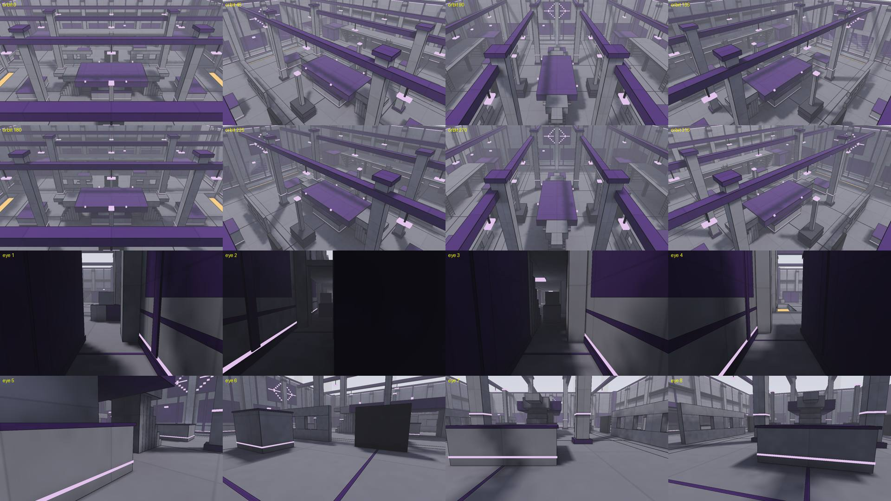

Features: ladders, lethal drops, water / lava, wallbangs, 5+ floor levels, indoor and outdoor, irregular outline, lit interiors

- ffa: 12 spawns, closest pair 6 m, 39% of spawn pairs see each other
- 1v1: 1v1: A 42 m, B 42 m (fairness 1.00), 4.4 s apart at 9.5 m/s
- ranked: ranked: 52% of sightlines in rifle/rocket range (< 20 m), 48% in laser/crossbow/sniper range (> 20 m)
- routes: all 72 spawn-to-objective routes walkable (the player's hull against the map's collision)
- most similar map: furnace (distance 0.34)

### bastion

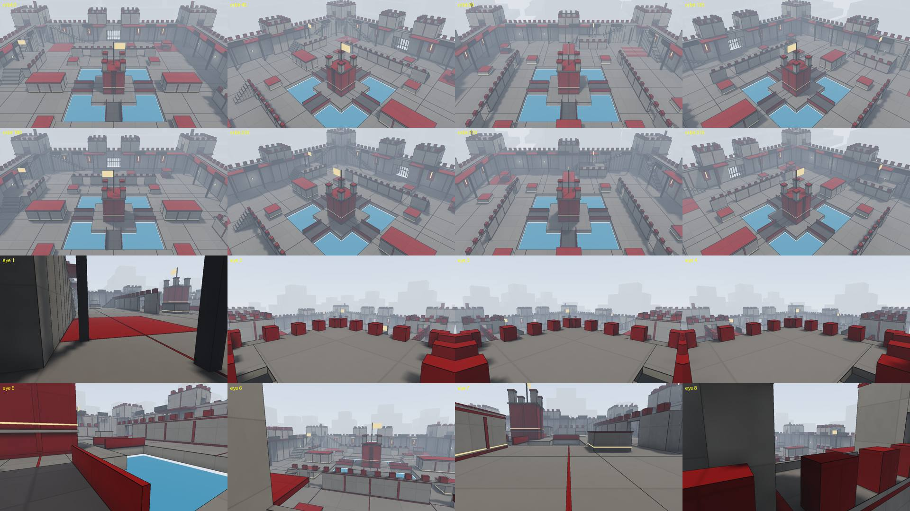

Features: ladders, lethal drops, water / lava, wallbangs, moving cart, 5+ floor levels, 12 m+ of height, indoor and outdoor, lit interiors

- vs: vs: A 57 m, B 57 m (fairness 1.00), 6.0 s apart at 9.5 m/s
- ffa: 21 spawns, closest pair 2 m, 40% of spawn pairs see each other
- routes: all 114 spawn-to-objective routes walkable (the player's hull against the map's collision)
- most similar map: canal (distance 0.39)

### canal

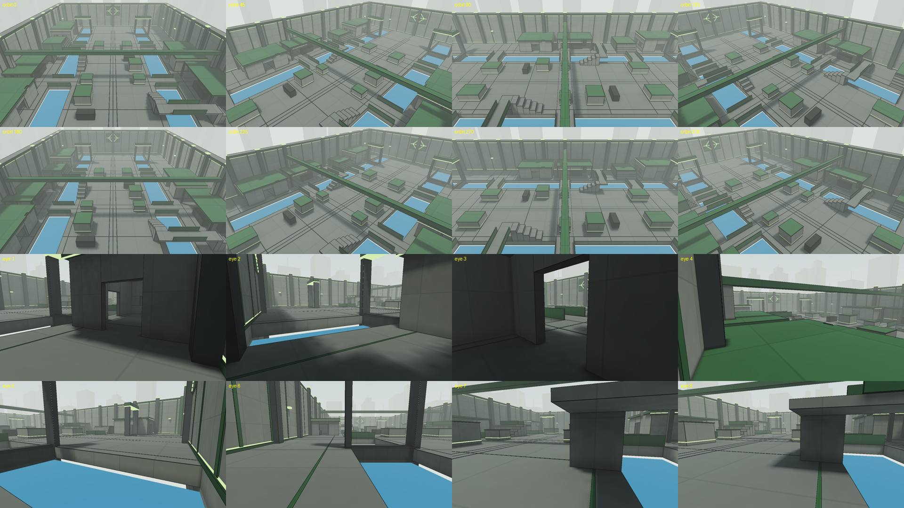

Features: ladders, lethal drops, water / lava, wallbangs, moving cart, 5+ floor levels, irregular outline, lit interiors

- ffa: 16 spawns, closest pair 3 m, 27% of spawn pairs see each other
- npayload: to the cart: A 41 m, B 41 m (fairness 1.00)
- routes: all 216 spawn-to-objective routes walkable (the player's hull against the map's collision)
- most similar map: foundry (distance 0.28)

### clockwork

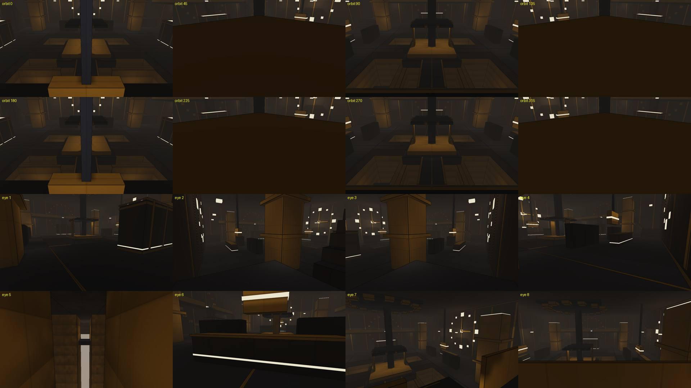

Features: ladders, lethal drops, wallbangs, 5+ floor levels, fully indoor, irregular outline, lit interiors

- ffa: 12 spawns, closest pair 3 m, 36% of spawn pairs see each other
- duel: duel: A 37 m, B 37 m (fairness 1.00), 3.9 s apart at 9.5 m/s
- routes: all 72 spawn-to-objective routes walkable (the player's hull against the map's collision)
- most similar map: anvil (distance 0.36)

### colosseum

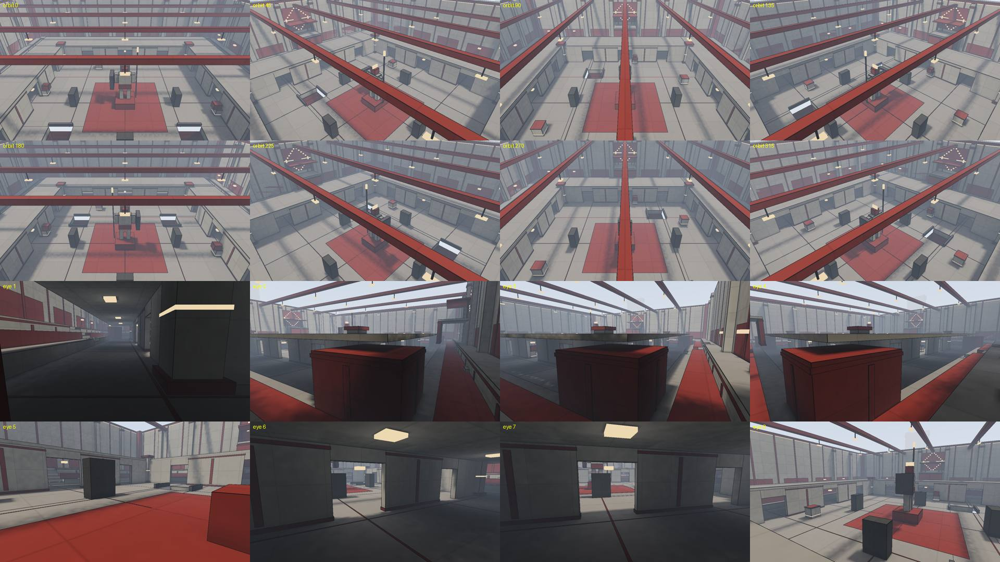

Features: ladders, lethal drops, wallbangs, moving cart, 5+ floor levels, indoor and outdoor, irregular outline, lit interiors

- ffa: 18 spawns, closest pair 1 m, 32% of spawn pairs see each other
- tourney: tourney: A 43 m, B 42 m (fairness 1.00), 4.5 s apart at 9.5 m/s; 18 spawns, closest pair 1 m, 32% of spawn pairs see each other
- routes: all 96 spawn-to-objective routes walkable (the player's hull against the map's collision)
- most similar map: harbor (distance 0.35)

### depot

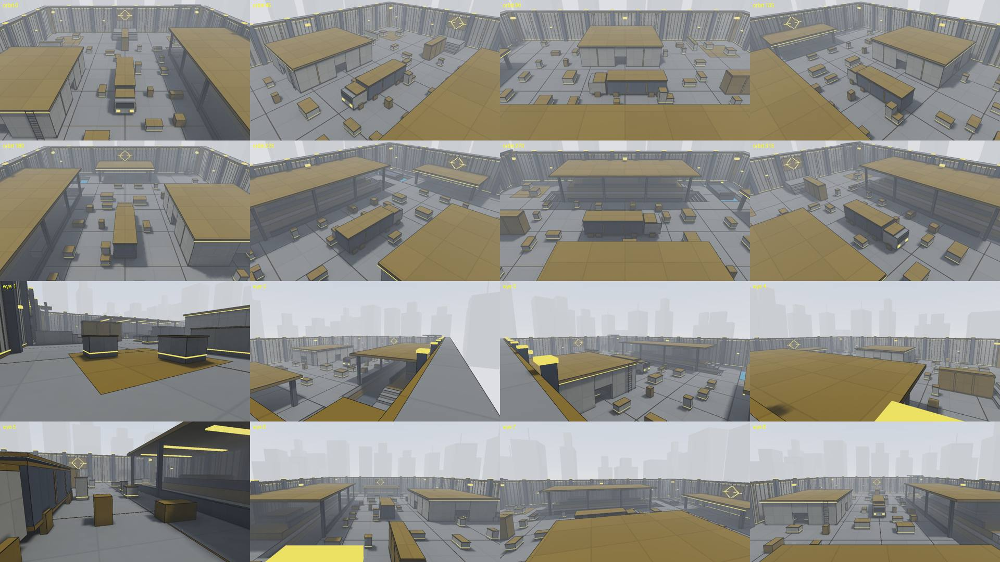

Features: ladders, lethal drops, water / lava, wallbangs, 5+ floor levels, indoor and outdoor, irregular outline, lit interiors

- bomb: site 1: attackers (A) 52 m, defenders (B) 55 m, attackers first by 0.3 s; site 2: attackers (A) 64 m, defenders (B) 63 m, defenders first by 0.1 s (-1..+1 s at every site)
- ffa: 19 spawns, closest pair 2 m, 25% of spawn pairs see each other
- routes: all 86 spawn-to-objective routes walkable (the player's hull against the map's collision)
- most similar map: railyard (distance 0.35)

### dojo

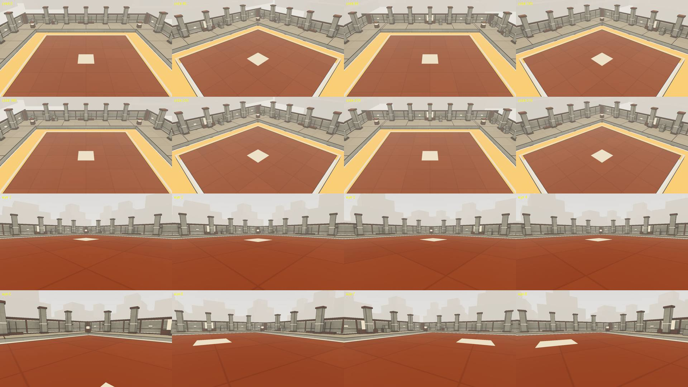

Features: lethal drops, water / lava, irregular outline, lit interiors

- ffa: 10 spawns, closest pair 3 m, 100% of spawn pairs see each other
- 1v1: 1v1: A 16 m, B 16 m (fairness 1.00), 1.7 s apart at 9.5 m/s
- ranked: ranked: 93% of sightlines in rifle/rocket range (< 20 m), 7% in laser/crossbow/sniper range (> 20 m)
- routes: all 66 spawn-to-objective routes walkable (the player's hull against the map's collision)
- most similar map: depot (distance 2.44)

### downtown

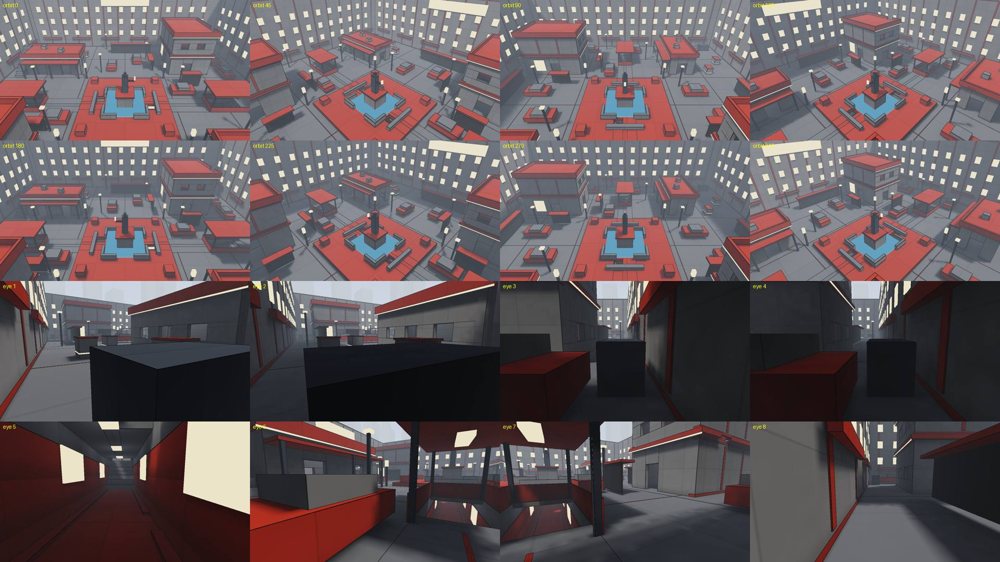

Features: ladders, lethal drops, wallbangs, 5+ floor levels, 12 m+ of height, indoor and outdoor, irregular outline, lit interiors

- koth: to the hill: A 21 m, B 21 m (fairness 1.00)
- ffa: 16 spawns, closest pair 3 m, 23% of spawn pairs see each other
- routes: all 72 spawn-to-objective routes walkable (the player's hull against the map's collision)
- most similar map: orbital (distance 0.39)

### foundry

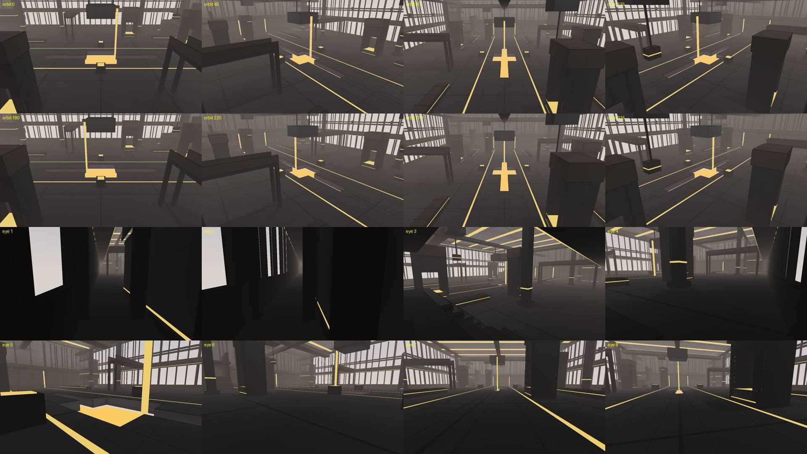

Features: ladders, lethal drops, water / lava, wallbangs, moving cart, 5+ floor levels, indoor and outdoor, irregular outline, lit interiors

- ffa: 19 spawns, closest pair 2 m, 73% of spawn pairs see each other
- tag: 4% of floor is a hiding spot (seen from < 5% of the map)
- routes: all 100 spawn-to-objective routes walkable (the player's hull against the map's collision)
- most similar map: canal (distance 0.28)

### furnace

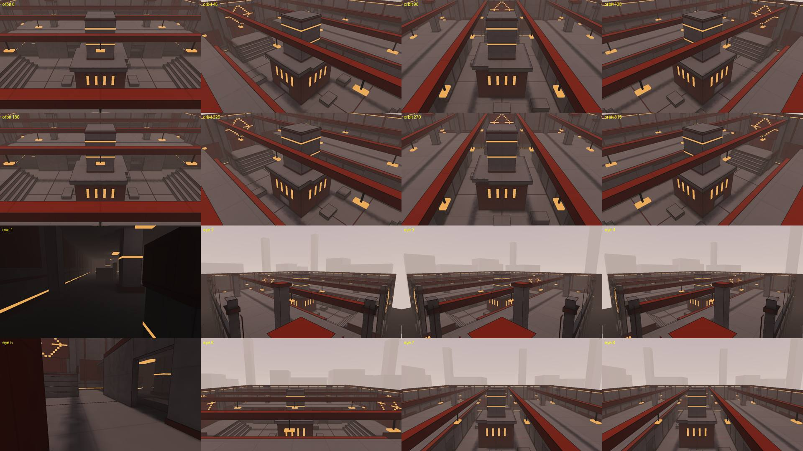

Features: ladders, lethal drops, water / lava, wallbangs, 5+ floor levels, indoor and outdoor, irregular outline, lit interiors

- ffa: 12 spawns, closest pair 4 m, 30% of spawn pairs see each other
- 1v1: 1v1: A 39 m, B 39 m (fairness 1.00), 4.1 s apart at 9.5 m/s
- ranked: ranked: 64% of sightlines in rifle/rocket range (< 20 m), 36% in laser/crossbow/sniper range (> 20 m)
- routes: all 72 spawn-to-objective routes walkable (the player's hull against the map's collision)
- most similar map: anvil (distance 0.34)

### gantry

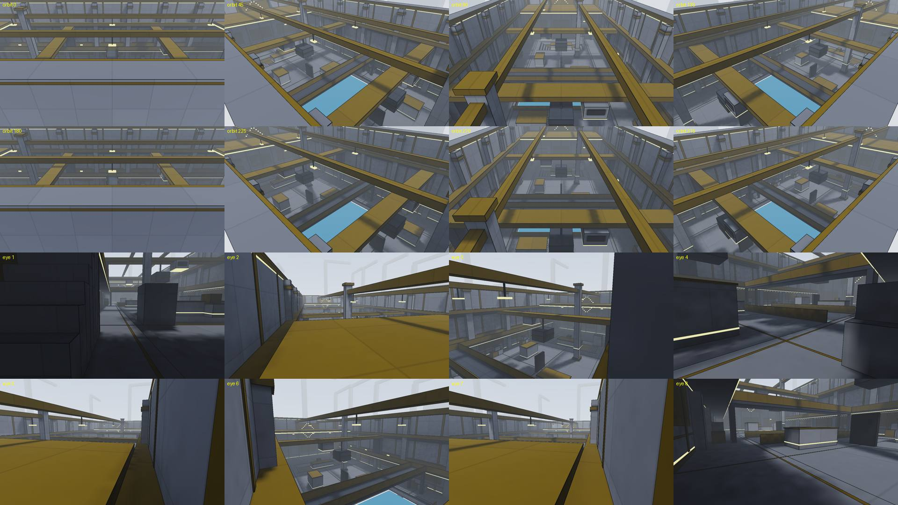

Features: ladders, lethal drops, water / lava, wallbangs, 5+ floor levels, 12 m+ of height, indoor and outdoor, lit interiors

- ffa: 14 spawns, closest pair 4 m, 17% of spawn pairs see each other
- ranked: ranked: 26% of sightlines in rifle/rocket range (< 20 m), 74% in laser/crossbow/sniper range (> 20 m)
- routes: all 196 spawn-to-objective routes walkable (the player's hull against the map's collision)
- most similar map: hamlet (distance 0.47)

### hamlet

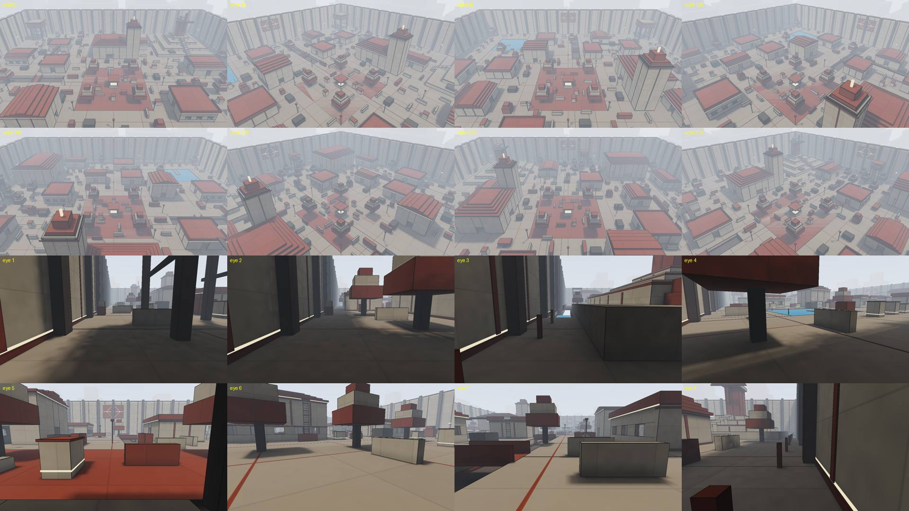

Features: ladders, water / lava, wallbangs, 5+ floor levels, 12 m+ of height, indoor and outdoor, lit interiors, lots of hiding spots

- ffa: 20 spawns, closest pair 10 m, 12% of spawn pairs see each other
- hide: 21% of floor is a hiding spot (seen from < 5% of the map)
- routes: all 400 spawn-to-objective routes walkable (the player's hull against the map's collision)
- most similar map: midtown (distance 0.31)

### harbor

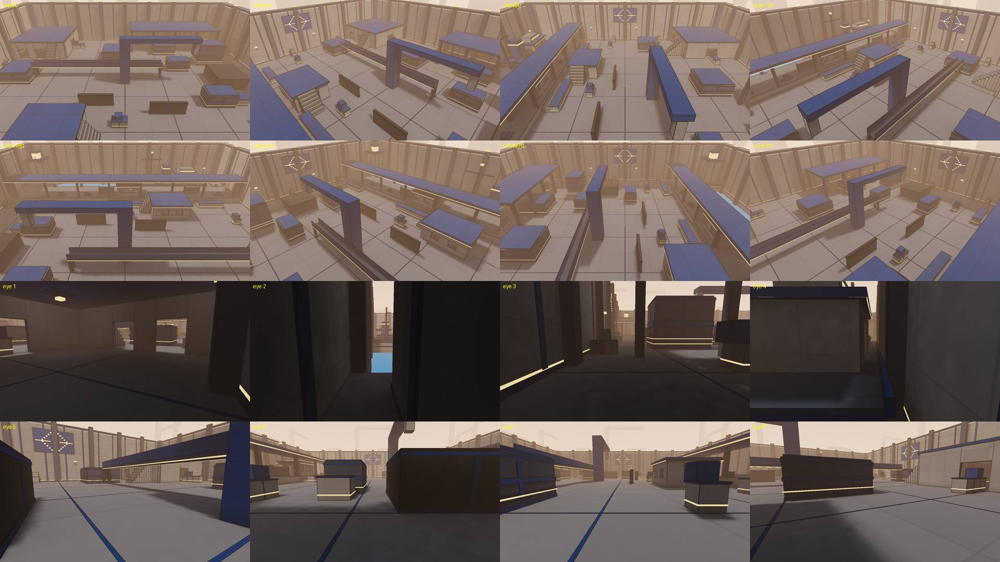

Features: ladders, lethal drops, water / lava, wallbangs, 5+ floor levels, indoor and outdoor, irregular outline, lit interiors

- ffa: 12 spawns, closest pair 1 m, 19% of spawn pairs see each other
- routes: all 100 spawn-to-objective routes walkable (the player's hull against the map's collision)
- most similar map: canal (distance 0.33)

### hightown

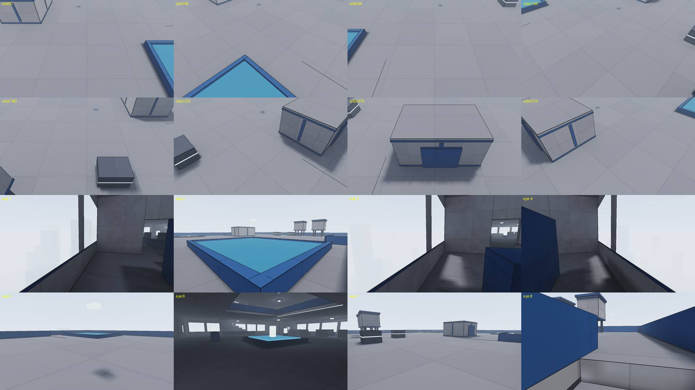

Features: lethal drops, water / lava, 5+ floor levels, 12 m+ of height, indoor and outdoor, irregular outline, lit interiors, lots of hiding spots

- ffa: 12 spawns, closest pair 11 m, 9% of spawn pairs see each other
- hide: 15% of floor is a hiding spot (seen from < 5% of the map)
- tag: 15% of floor is a hiding spot (seen from < 5% of the map)
- routes: all 144 spawn-to-objective routes walkable (the player's hull against the map's collision)
- most similar map: lodestone (distance 0.96)

### lodestone

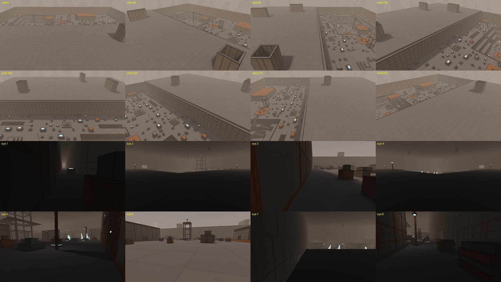

Features: ladders, water / lava, moving cart, 5+ floor levels, 12 m+ of height, indoor and outdoor, lit interiors, lots of hiding spots

- bomb: site 1: attackers (A) 82 m, defenders (B) 77 m, defenders first by 0.6 s; site 2: attackers (A) 93 m, defenders (B) 97 m, attackers first by 0.5 s (-1..+1 s at every site)
- race: 6 checkpoints, route 525 m walked (55 s at 9.5 m/s, 26 s at 20 m/s)
- koth: to the hill: A 82 m, B 77 m (fairness 0.94)
- payload: attackers (A) 22 m to the cart, defenders (B) 82 m to the halfway point (track 140 m)
- ffa: 92 spawns, closest pair 0 m, 12% of spawn pairs see each other
- npayload: to the cart: A 71 m, B 82 m (fairness 0.87)
- hide: 46% of floor is a hiding spot (seen from < 5% of the map)
- tag: 46% of floor is a hiding spot (seen from < 5% of the map)
- points: 5 points; A: attackers 79 m, defenders 76 m, defenders first by 0.3 s; B: attackers 69 m, defenders 63 m, defenders first by 0.6 s; C: attackers 62 m, defenders 62 m, defenders first by 0.0 s; D: attackers 72 m, defenders 74 m, attackers first by 0.2 s; E: attackers 63 m, defenders 67 m, attackers first by 0.4 s; (-1..+1 s at every point)
- routes: all 5592 spawn-to-objective routes walkable (the player's hull against the map's collision)
- most similar map: midtown (distance 0.18)

### midtown

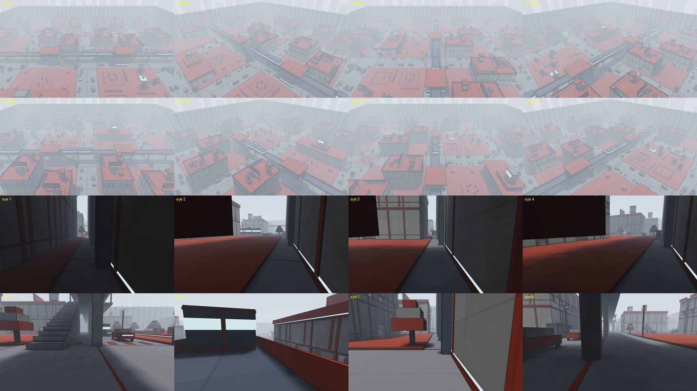

Features: ladders, water / lava, wallbangs, 5+ floor levels, 12 m+ of height, indoor and outdoor, lit interiors, lots of hiding spots

- ffa: 68 spawns, closest pair 2 m, 13% of spawn pairs see each other
- points: 5 points; A: attackers 64 m, defenders 66 m, attackers first by 0.2 s; B: attackers 75 m, defenders 71 m, defenders first by 0.4 s; C: attackers 62 m, defenders 62 m, defenders first by 0.0 s; D: attackers 50 m, defenders 45 m, defenders first by 0.6 s; E: attackers 61 m, defenders 60 m, defenders first by 0.1 s; (-1..+1 s at every point)
- routes: all 244 spawn-to-objective routes walkable (the player's hull against the map's collision)
- most similar map: lodestone (distance 0.18)

### orbital

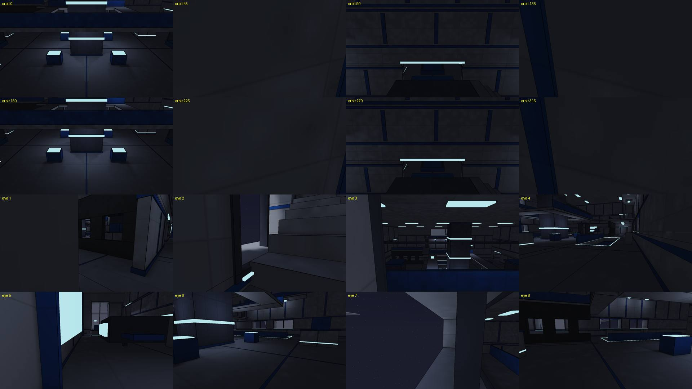

Features: ladders, lethal drops, wallbangs, 5+ floor levels, fully indoor, irregular outline, lit interiors

- vs: vs: A 43 m, B 43 m (fairness 1.00), 4.5 s apart at 9.5 m/s
- ffa: 16 spawns, closest pair 4 m, 10% of spawn pairs see each other
- routes: all 96 spawn-to-objective routes walkable (the player's hull against the map's collision)
- most similar map: anvil (distance 0.38)

### railyard

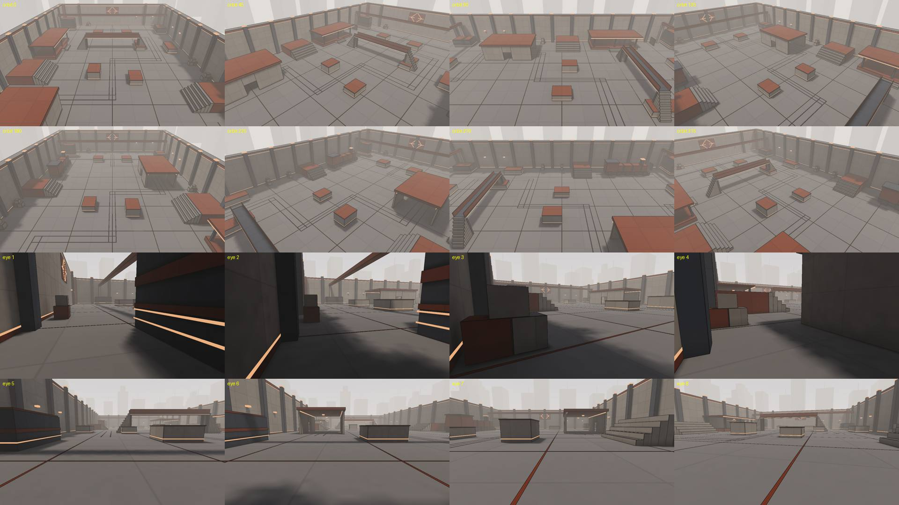

Features: ladders, wallbangs, moving cart, 5+ floor levels, 12 m+ of height, indoor and outdoor, irregular outline, lit interiors

- payload: attackers (A) 6 m to the cart, defenders (B) 44 m to the halfway point (track 136 m)
- ffa: 16 spawns, closest pair 3 m, 24% of spawn pairs see each other
- routes: all 344 spawn-to-objective routes walkable (the player's hull against the map's collision)
- most similar map: harbor (distance 0.33)

### summit

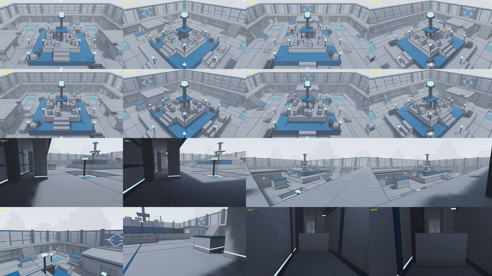

Features: ladders, lethal drops, water / lava, wallbangs, 5+ floor levels, indoor and outdoor, irregular outline, lit interiors

- koth: to the hill: A 64 m, B 64 m (fairness 1.00)
- ffa: 18 spawns, closest pair 4 m, 13% of spawn pairs see each other
- routes: all 74 spawn-to-objective routes walkable (the player's hull against the map's collision)
- most similar map: anvil (distance 0.34)

### temple

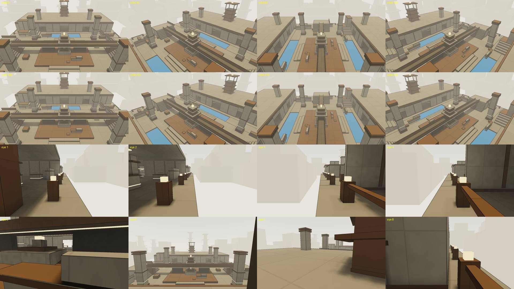

Features: ladders, lethal drops, water / lava, wallbangs, 5+ floor levels, 12 m+ of height, indoor and outdoor, lit interiors

- ffa: 12 spawns, closest pair 6 m, 24% of spawn pairs see each other
- 1v1: 1v1: A 61 m, B 61 m (fairness 1.00), 6.5 s apart at 9.5 m/s
- ranked: ranked: 42% of sightlines in rifle/rocket range (< 20 m), 58% in laser/crossbow/sniper range (> 20 m)
- routes: all 72 spawn-to-objective routes walkable (the player's hull against the map's collision)
- most similar map: colosseum (distance 0.50)

### viaduct

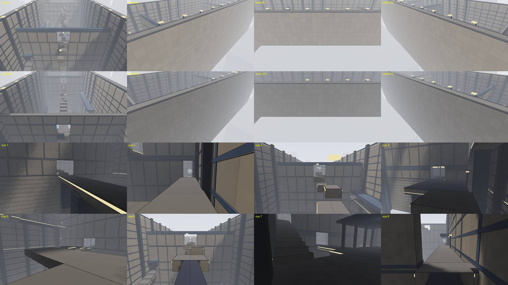

Features: ladders, lethal drops, water / lava, 5+ floor levels, 12 m+ of height, indoor and outdoor, irregular outline, lit interiors, lots of hiding spots

- race: 12 checkpoints, route 972 m walked (102 s at 9.5 m/s, 49 s at 20 m/s)
- ffa: 16 spawns, closest pair 2 m, 71% of spawn pairs see each other
- routes: all 160 spawn-to-objective routes walkable (the player's hull against the map's collision)
- most similar map: hightown (distance 1.71)

