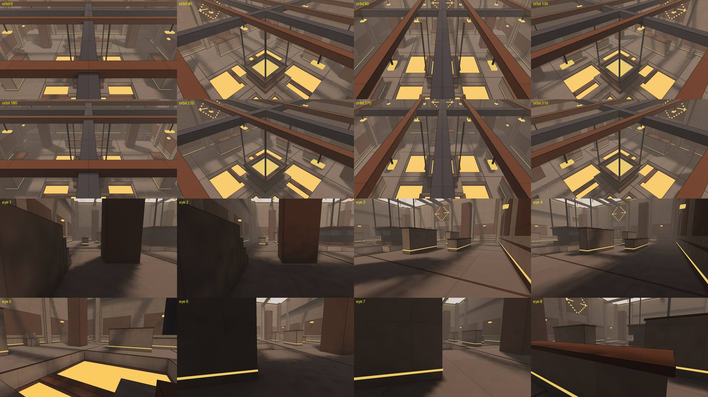

# Map report

Generated by `build/quark_tests mapreport` from the map files, the bot nav graph and line-of-sight rays. Metric definitions and score formulas: [MAP_METRICS.md](MAP_METRICS.md). Scores are 0-10; a dash means not applicable.

## Scores

| map | for | decor | layout | movement | creativity | originality | balance |
|---|---|---|---|---|---|---|---|
| anvil | 1v1 | 8.3 | 5.2 | 8.0 | 6.2 | 2.9 | 10.0 |
| bastion | vs | 5.3 | 8.7 | 8.2 | 7.1 | 9.1 | 10.0 |
| canal | npayload | 6.0 | 6.6 | 8.0 | 7.1 | 1.4 | 10.0 |
| colosseum | tourney | 6.2 | 7.9 | 8.2 | 7.7 | 4.3 | 8.3 |
| crucible | duel | 8.3 | 8.2 | 7.2 | 5.6 | 2.9 | 10.0 |
| depot | bomb | 4.0 | 7.2 | 7.9 | 6.2 | 3.9 | 9.6 |
| foundry | any | 6.9 | 6.6 | 7.3 | 7.1 | 6.6 | 10.0 |
| furnace | 1v1 | 9.0 | 8.4 | 7.5 | 6.2 | 3.3 | 10.0 |
| gantry | 1v1 | 8.0 | 8.2 | 8.2 | 6.2 | 4.3 | 10.0 |
| hamlet | hide | 6.4 | 5.6 | 9.3 | 7.1 | 6.3 | - |
| harbor | ffa | 4.1 | 5.8 | 8.3 | 6.2 | 2.2 | 10.0 |
| railyard | payload | 6.2 | 3.9 | 8.1 | 7.7 | 1.4 | 9.9 |
| summit | koth | 3.5 | 6.9 | 8.0 | 5.6 | 4.3 | 10.0 |
| temple | 1v1 | 7.8 | 7.0 | 7.9 | 6.2 | 3.8 | 10.0 |
| viaduct | race | 3.4 | 6.5 | 7.7 | 5.6 | 10.0 | - |

## Decor / detail

| map | brushes | detail | per 100 m² | bare walls | materials | glow | metal | lights | skyline |
|---|---|---|---|---|---|---|---|---|---|
| anvil | 370 | 286 | 9.2 | 11% | 6 | 97 | 18 | 24 | 30 |
| bastion | 759 | 529 | 7.3 | 66% | 6 | 38 | 27 | 22 | 68 |
| canal | 455 | 329 | 7.2 | 49% | 6 | 120 | 42 | 24 | 60 |
| colosseum | 413 | 281 | 5.7 | 40% | 6 | 95 | 23 | 29 | 62 |
| crucible | 322 | 229 | 10.9 | 21% | 6 | 89 | 27 | 23 | 30 |
| depot | 354 | 239 | 4.3 | 55% | 6 | 115 | 37 | 11 | 52 |
| foundry | 545 | 425 | 4.3 | 13% | 7 | 92 | 244 | 35 | 8 |
| furnace | 316 | 241 | 10.9 | 5% | 7 | 106 | 16 | 24 | 26 |
| gantry | 362 | 263 | 8.8 | 8% | 6 | 90 | 32 | 21 | 52 |
| hamlet | 1133 | 929 | 4.8 | 26% | 5 | 186 | 134 | 28 | 80 |
| harbor | 359 | 239 | 4.5 | 59% | 7 | 122 | 42 | 14 | 54 |
| railyard | 518 | 390 | 6.0 | 42% | 6 | 127 | 81 | 28 | 60 |
| summit | 365 | 228 | 4.9 | 74% | 6 | 121 | 25 | 13 | 64 |
| temple | 463 | 314 | 7.5 | 7% | 6 | 112 | 17 | 24 | 84 |
| viaduct | 498 | 231 | 6.6 | 92% | 5 | 188 | 47 | 13 | 85 |

## Layout and sightlines

| map | floor m² | levels | height range | loops | dead ends | visible pairs | <6 m | 6-20 m | 20-32 m | >32 m | cover |
|---|---|---|---|---|---|---|---|---|---|---|---|
| anvil | 3102 | 5 | 12.0 m | 34 | 11 | 50% | 5% | 37% | 34% | 24% | 31% |
| bastion | 7239 | 7 | 11.9 m | 762 | 2 | 35% | 5% | 30% | 26% | 39% | 44% |
| canal | 4571 | 8 | 10.6 m | 42 | 0 | 59% | 3% | 21% | 26% | 51% | 23% |
| colosseum | 4961 | 7 | 27.4 m | 83 | 0 | 42% | 5% | 30% | 27% | 37% | 32% |
| crucible | 2106 | 6 | 14.0 m | 65 | 2 | 50% | 7% | 36% | 33% | 23% | 37% |
| depot | 5528 | 7 | 12.1 m | 102 | 2 | 51% | 3% | 25% | 26% | 45% | 25% |
| foundry | 9937 | 10 | 16.8 m | 188 | 3 | 40% | 3% | 21% | 27% | 49% | 16% |
| furnace | 2214 | 5 | 10.0 m | 49 | 0 | 39% | 8% | 44% | 29% | 19% | 40% |
| gantry | 2978 | 8 | 27.4 m | 47 | 2 | 55% | 4% | 33% | 37% | 26% | 39% |
| hamlet | 19420 | 12 | 19.5 m | 145 | 6 | 23% | 2% | 17% | 19% | 62% | 28% |
| harbor | 5332 | 8 | 12.6 m | 42 | 5 | 55% | 3% | 23% | 25% | 48% | 24% |
| railyard | 6501 | 7 | 10.6 m | 39 | 13 | 59% | 2% | 20% | 24% | 54% | 22% |
| summit | 4684 | 6 | 12.3 m | 70 | 4 | 53% | 4% | 30% | 32% | 33% | 32% |
| temple | 4170 | 6 | 12.8 m | 48 | 0 | 33% | 6% | 39% | 30% | 24% | 28% |
| viaduct | 3506 | 17 | 40.6 m | 89 | 4 | 47% | 2% | 8% | 11% | 79% | 25% |

## Movement

| map | grapple anchors | headroom > 6 m | speed lanes (p90) | jump links | ladders | near a lethal drop |
|---|---|---|---|---|---|---|
| anvil | 80% | 100% | 40 m | 48% | 0 | 18% |
| bastion | 83% | 99% | 49 m | 52% | 0 | 15% |
| canal | 72% | 91% | 60 m | 64% | 0 | 35% |
| colosseum | 85% | 98% | 47 m | 52% | 0 | 17% |
| crucible | 76% | 99% | 34 m | 40% | 0 | 37% |
| depot | 65% | 95% | 57 m | 71% | 0 | 13% |
| foundry | 48% | 87% | 60 m | 76% | 0 | 8% |
| furnace | 72% | 99% | 34 m | 51% | 0 | 36% |
| gantry | 80% | 87% | 53 m | 67% | 0 | 28% |
| hamlet | 85% | 86% | 60 m | 67% | 12 | 6% |
| harbor | 81% | 93% | 57 m | 67% | 0 | 17% |
| railyard | 74% | 94% | 60 m | 74% | 0 | 11% |
| summit | 70% | 96% | 45 m | 64% | 0 | 23% |
| temple | 83% | 97% | 49 m | 45% | 0 | 15% |
| viaduct | 68% | 98% | 60 m | 51% | 0 | 81% |

## Per map: shots and modes

### anvil

Features: lethal drops, wallbangs, 5 floor levels, grapple-friendly, long speed lanes, lit interiors, skyline

- vs: A to B spawns 38 m, B to A 38 m (fairness 1.00, 4.8 s apart at 8 m/s)
- ffa: 6 spawns, closest pair 8 m, 53% of spawn pairs see each other
- duel: A to B spawns 38 m, B to A 38 m (fairness 1.00, 4.8 s apart at 8 m/s)
- 1v1: A to B spawns 38 m, B to A 38 m (fairness 1.00, 4.8 s apart at 8 m/s)
- tourney: 6 spawns, closest pair 8 m, 53% of spawn pairs see each other
- hide: 1% of floor is a hiding spot (seen from < 5% of the map)
- tag: 1% of floor is a hiding spot (seen from < 5% of the map)
- ranked: ranked: 42% of sightlines in rifle/rocket range (< 20 m), 58% in laser/crossbow/sniper range (> 20 m)
- most similar map: crucible (distance 0.36)

### bastion

Features: lethal drops, moving cart, 7 floor levels, grapple-friendly, long speed lanes, lit interiors, skyline

- vs: A to B spawns 57 m, B to A 57 m (fairness 1.00, 7.1 s apart at 8 m/s)
- bomb: nearest site: attackers (A) 72 m, defenders (B) 20 m - defenders should arrive first
- race: 4 checkpoints, route 196 m walked (25 s at 8 m/s, 10 s at 20 m/s)
- koth: to the hill: A 26 m, B 26 m (fairness 1.00)
- payload: attackers (A) 10 m to the cart, defenders (B) 40 m to the halfway point (track 57 m)
- ffa: 19 spawns, closest pair 2 m, 44% of spawn pairs see each other
- npayload: to the cart: A 40 m, B 40 m (fairness 1.00)
- duel: A to B spawns 57 m, B to A 57 m (fairness 1.00, 7.1 s apart at 8 m/s)
- 1v1: A to B spawns 57 m, B to A 57 m (fairness 1.00, 7.1 s apart at 8 m/s)
- tourney: 19 spawns, closest pair 2 m, 44% of spawn pairs see each other
- hide: 7% of floor is a hiding spot (seen from < 5% of the map)
- tag: 7% of floor is a hiding spot (seen from < 5% of the map)
- most similar map: temple (distance 1.13)

### canal

Features: lethal drops, moving cart, 8 floor levels, grapple-friendly, long speed lanes, lit interiors, skyline

- vs: A to B spawns 80 m, B to A 80 m (fairness 1.00, 10.0 s apart at 8 m/s)
- payload: attackers (A) 5 m to the cart, defenders (B) 40 m to the halfway point (track 72 m)
- ffa: 10 spawns, closest pair 4 m, 46% of spawn pairs see each other
- npayload: to the cart: A 40 m, B 40 m (fairness 1.00)
- duel: A to B spawns 80 m, B to A 80 m (fairness 1.00, 10.0 s apart at 8 m/s)
- 1v1: A to B spawns 80 m, B to A 80 m (fairness 1.00, 10.0 s apart at 8 m/s)
- tourney: 10 spawns, closest pair 4 m, 46% of spawn pairs see each other
- hide: 0% of floor is a hiding spot (seen from < 5% of the map)
- tag: 0% of floor is a hiding spot (seen from < 5% of the map)
- most similar map: railyard (distance 0.18)

### colosseum

Features: lethal drops, wallbangs, moving cart, 7 floor levels, grapple-friendly, long speed lanes, lit interiors, skyline

- vs: A to B spawns 43 m, B to A 42 m (fairness 1.00, 5.3 s apart at 8 m/s)
- bomb: nearest site: attackers (A) 45 m, defenders (B) 13 m - defenders should arrive first
- race: 4 checkpoints, route 148 m walked (18 s at 8 m/s, 7 s at 20 m/s)
- koth: to the hill: A 24 m, B 19 m (fairness 0.76)
- payload: attackers (A) 6 m to the cart, defenders (B) 19 m to the halfway point (track 43 m)
- ffa: 16 spawns, closest pair 1 m, 34% of spawn pairs see each other
- npayload: to the cart: A 48 m, B 19 m (fairness 0.40)
- duel: A to B spawns 43 m, B to A 42 m (fairness 1.00, 5.3 s apart at 8 m/s)
- 1v1: A to B spawns 43 m, B to A 42 m (fairness 1.00, 5.3 s apart at 8 m/s)
- tourney: 16 spawns, closest pair 1 m, 34% of spawn pairs see each other
- hide: 1% of floor is a hiding spot (seen from < 5% of the map)
- tag: 1% of floor is a hiding spot (seen from < 5% of the map)
- most similar map: gantry (distance 0.54)

### crucible

Features: lethal drops, 6 floor levels, grapple-friendly, long speed lanes, lit interiors, skyline

- vs: A to B spawns 37 m, B to A 37 m (fairness 1.00, 4.6 s apart at 8 m/s)
- ffa: 6 spawns, closest pair 8 m, 40% of spawn pairs see each other
- duel: A to B spawns 37 m, B to A 37 m (fairness 1.00, 4.6 s apart at 8 m/s)
- 1v1: A to B spawns 37 m, B to A 37 m (fairness 1.00, 4.6 s apart at 8 m/s)
- tourney: 6 spawns, closest pair 8 m, 40% of spawn pairs see each other
- hide: 0% of floor is a hiding spot (seen from < 5% of the map)
- tag: 0% of floor is a hiding spot (seen from < 5% of the map)
- most similar map: anvil (distance 0.36)

### depot

Features: lethal drops, wallbangs, 7 floor levels, grapple-friendly, long speed lanes, lit interiors, skyline

- vs: A to B spawns 68 m, B to A 65 m (fairness 0.96, 8.5 s apart at 8 m/s)
- bomb: nearest site: attackers (A) 63 m, defenders (B) 19 m - defenders should arrive first
- ffa: 12 spawns, closest pair 4 m, 59% of spawn pairs see each other
- duel: A to B spawns 68 m, B to A 65 m (fairness 0.96, 8.5 s apart at 8 m/s)
- 1v1: A to B spawns 68 m, B to A 65 m (fairness 0.96, 8.5 s apart at 8 m/s)
- tourney: 12 spawns, closest pair 4 m, 59% of spawn pairs see each other
- hide: 2% of floor is a hiding spot (seen from < 5% of the map)
- tag: 2% of floor is a hiding spot (seen from < 5% of the map)
- most similar map: harbor (distance 0.49)

### foundry

Features: lethal drops, wallbangs, moving cart, 10 floor levels, long speed lanes, lit interiors, skyline

- vs: A to B spawns 67 m, B to A 67 m (fairness 1.00, 8.4 s apart at 8 m/s)
- bomb: nearest site: attackers (A) 29 m, defenders (B) 29 m - defenders should arrive first
- race: 4 checkpoints, route 233 m walked (29 s at 8 m/s, 12 s at 20 m/s)
- koth: to the hill: A 19 m, B 19 m (fairness 1.00)
- payload: attackers (A) 4 m to the cart, defenders (B) 45 m to the halfway point (track 57 m)
- ffa: 19 spawns, closest pair 3 m, 78% of spawn pairs see each other
- npayload: to the cart: A 45 m, B 45 m (fairness 1.00)
- duel: A to B spawns 67 m, B to A 67 m (fairness 1.00, 8.4 s apart at 8 m/s)
- 1v1: A to B spawns 67 m, B to A 67 m (fairness 1.00, 8.4 s apart at 8 m/s)
- tourney: 19 spawns, closest pair 3 m, 78% of spawn pairs see each other
- hide: 1% of floor is a hiding spot (seen from < 5% of the map)
- tag: 1% of floor is a hiding spot (seen from < 5% of the map)
- most similar map: depot (distance 0.82)

### furnace

Features: lethal drops, wallbangs, 5 floor levels, grapple-friendly, long speed lanes, lit interiors, skyline

- vs: A to B spawns 39 m, B to A 39 m (fairness 1.00, 4.9 s apart at 8 m/s)
- ffa: 6 spawns, closest pair 8 m, 13% of spawn pairs see each other
- duel: A to B spawns 39 m, B to A 39 m (fairness 1.00, 4.9 s apart at 8 m/s)
- 1v1: A to B spawns 39 m, B to A 39 m (fairness 1.00, 4.9 s apart at 8 m/s)
- tourney: 6 spawns, closest pair 8 m, 13% of spawn pairs see each other
- hide: 0% of floor is a hiding spot (seen from < 5% of the map)
- tag: 0% of floor is a hiding spot (seen from < 5% of the map)
- ranked: ranked: 52% of sightlines in rifle/rocket range (< 20 m), 48% in laser/crossbow/sniper range (> 20 m)
- most similar map: crucible (distance 0.41)

### gantry

Features: lethal drops, wallbangs, 8 floor levels, grapple-friendly, long speed lanes, lit interiors, skyline

- vs: A to B spawns 65 m, B to A 65 m (fairness 1.00, 8.1 s apart at 8 m/s)
- ffa: 6 spawns, closest pair 6 m, 73% of spawn pairs see each other
- duel: A to B spawns 65 m, B to A 65 m (fairness 1.00, 8.1 s apart at 8 m/s)
- 1v1: A to B spawns 65 m, B to A 65 m (fairness 1.00, 8.1 s apart at 8 m/s)
- tourney: 6 spawns, closest pair 6 m, 73% of spawn pairs see each other
- hide: 1% of floor is a hiding spot (seen from < 5% of the map)
- tag: 1% of floor is a hiding spot (seen from < 5% of the map)
- ranked: ranked: 37% of sightlines in rifle/rocket range (< 20 m), 63% in laser/crossbow/sniper range (> 20 m)
- most similar map: colosseum (distance 0.54)

### hamlet

Features: ladders, lethal drops, 12 floor levels, grapple-friendly, long speed lanes, lit interiors, skyline

- ffa: 20 spawns, closest pair 10 m, 23% of spawn pairs see each other
- hide: 10% of floor is a hiding spot (seen from < 5% of the map)
- tag: 10% of floor is a hiding spot (seen from < 5% of the map)
- most similar map: harbor (distance 0.79)

### harbor

Features: lethal drops, wallbangs, 8 floor levels, grapple-friendly, long speed lanes, lit interiors, skyline

- vs: A to B spawns 28 m, B to A 28 m (fairness 1.00, 3.5 s apart at 8 m/s)
- ffa: 12 spawns, closest pair 1 m, 43% of spawn pairs see each other
- duel: A to B spawns 28 m, B to A 28 m (fairness 1.00, 3.5 s apart at 8 m/s)
- 1v1: A to B spawns 28 m, B to A 28 m (fairness 1.00, 3.5 s apart at 8 m/s)
- tourney: 12 spawns, closest pair 1 m, 43% of spawn pairs see each other
- hide: 0% of floor is a hiding spot (seen from < 5% of the map)
- tag: 0% of floor is a hiding spot (seen from < 5% of the map)
- most similar map: railyard (distance 0.27)

### railyard

Features: lethal drops, wallbangs, moving cart, 7 floor levels, grapple-friendly, long speed lanes, lit interiors, skyline

- vs: A to B spawns 87 m, B to A 87 m (fairness 1.00, 10.9 s apart at 8 m/s)
- payload: attackers (A) 5 m to the cart, defenders (B) 44 m to the halfway point (track 136 m)
- ffa: 10 spawns, closest pair 4 m, 62% of spawn pairs see each other
- npayload: to the cart: A 43 m, B 44 m (fairness 0.98)
- duel: A to B spawns 87 m, B to A 87 m (fairness 1.00, 10.9 s apart at 8 m/s)
- 1v1: A to B spawns 87 m, B to A 87 m (fairness 1.00, 10.9 s apart at 8 m/s)
- tourney: 10 spawns, closest pair 4 m, 62% of spawn pairs see each other
- hide: 0% of floor is a hiding spot (seen from < 5% of the map)
- tag: 0% of floor is a hiding spot (seen from < 5% of the map)
- most similar map: canal (distance 0.18)

### summit

Features: lethal drops, 6 floor levels, grapple-friendly, long speed lanes, lit interiors, skyline

- vs: A to B spawns 52 m, B to A 52 m (fairness 1.00, 6.6 s apart at 8 m/s)
- koth: to the hill: A 65 m, B 65 m (fairness 1.00)
- ffa: 12 spawns, closest pair 4 m, 42% of spawn pairs see each other
- duel: A to B spawns 52 m, B to A 52 m (fairness 1.00, 6.6 s apart at 8 m/s)
- 1v1: A to B spawns 52 m, B to A 52 m (fairness 1.00, 6.6 s apart at 8 m/s)
- tourney: 12 spawns, closest pair 4 m, 42% of spawn pairs see each other
- hide: 0% of floor is a hiding spot (seen from < 5% of the map)
- tag: 0% of floor is a hiding spot (seen from < 5% of the map)
- most similar map: depot (distance 0.53)

### temple

Features: lethal drops, wallbangs, 6 floor levels, grapple-friendly, long speed lanes, lit interiors, skyline

- vs: A to B spawns 57 m, B to A 57 m (fairness 1.00, 7.2 s apart at 8 m/s)
- ffa: 6 spawns, closest pair 6 m, 13% of spawn pairs see each other
- duel: A to B spawns 57 m, B to A 57 m (fairness 1.00, 7.2 s apart at 8 m/s)
- 1v1: A to B spawns 57 m, B to A 57 m (fairness 1.00, 7.2 s apart at 8 m/s)
- tourney: 6 spawns, closest pair 6 m, 13% of spawn pairs see each other
- hide: 0% of floor is a hiding spot (seen from < 5% of the map)
- tag: 0% of floor is a hiding spot (seen from < 5% of the map)
- ranked: ranked: 46% of sightlines in rifle/rocket range (< 20 m), 54% in laser/crossbow/sniper range (> 20 m)
- most similar map: anvil (distance 0.48)

### viaduct

Features: lethal drops, 17 floor levels, grapple-friendly, long speed lanes, lit interiors, skyline

- race: 10 checkpoints, route 830 m walked (104 s at 8 m/s, 41 s at 20 m/s)
- most similar map: hamlet (distance 1.31)

